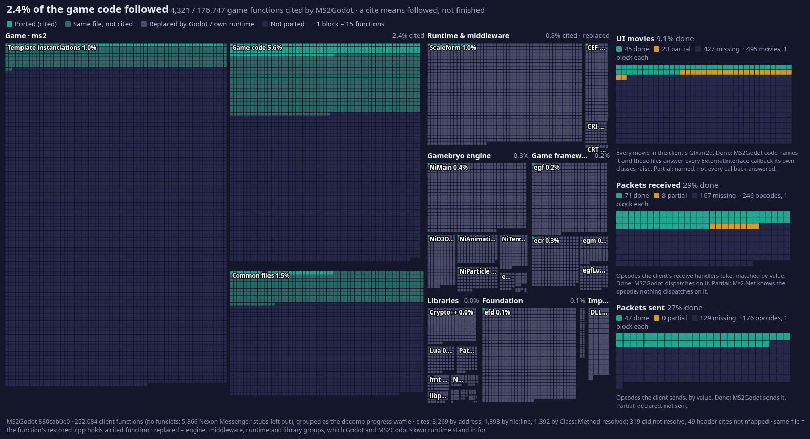

# MS2Godot

A MapleStory 2 client written in Godot 4 (C#). The parity target is the restored original client.

The project ships no game data. You bring your own MapleStory 2 client; MS2Godot reads its `.m2d` packs at
run time.

## Progress



The picture counts what MS2Godot has followed of the restored client. Every rule is mechanical, so it is redrawn
from the code after each merge with no hand marks.

- Client code (left): the client's functions, without exception-handling funclets and the Nexon Messenger stubs,
  in the decomp's progress groups. A function is *ported* when MS2Godot's code or comments cite it: by address
  (`@0x14…`, `FUN_14…`; an address inside a function counts for that function), by `file.cpp:LINE` (the function
  of the restored source whose body holds that line), or by a `Class::Method` name that matches exactly one client
  function. A cite means the function was followed, not that it is finished. *Same file*: a game function that is
  not cited, in a source file where another function is. The engine, middleware, runtime and library groups
  (Gamebryo, Scaleform, CRI, CEF, PhysX, the C runtime, Lua and the others) are *replaced*: Godot and MS2Godot's
  own runtime stand in for them, and a function there that is cited still shows as ported. The headline is ported
  functions over the game code and common files functions; the template instantiations are compiler-generated, so
  they are counted apart with their own share, and the figure with them is in the sub-line. The footer gives the
  cites of each kind and how many did not resolve.
- UI movies: the movies of the client's `Gfx.m2d` that the client loads: `UI` + a dialog type name of the restored
  source (a formatted name such as `DamageFont_{0}` covers every movie it can make), a string in the source that
  names the movie, a `.swf`/`.gfx` name in the XML tables or the font config, or a movie that one of those names
  inside its own bytes. The other movies are shown as an unused count and left out. A movie's callbacks are the
  `ExternalInterface.call` names its own classes raise (the shared library classes, the ones the small `uihpbar`
  movie also defines, such as the window base, are left out). *Done*: the movie's name is a string in MS2Godot's
  code, and those files (with the controller base) name every callback, compared without case as the client
  compares them. *Partial*: named, but not every callback is. *Missing*: never named.
- Packets: the opcodes the client receives and sends (its `RecvOp` and `SendOp` uses), matched by value to
  `Ms2.Net`'s `Inbound` and `Outbound` tables. Received: *done* when MS2Godot dispatches on it, *partial* when the
  table has it and nothing dispatches on it. Sent: *done* when MS2Godot sends it, *partial* when only the table has
  it. *Missing*: not in the table.

Current state: a field walk. The main scene loads one field (Tria, `02000001_tw_tria`, by default) and places
the player character at the field's player spawn point, dressed in a new character's starter look. It walks,
runs and climbs steps over the field's collision.

Game flow (`game/flow/`): setup, then login (any id and password), character select (stub list), create on an empty slot,
the field's loading picture, and the field with the HUD and the chosen character's job and gender. Esc in the field opens the client's
system menu (`uisystemmenudialog`): channel (one channel offline), switch characters (back to character select), exit
(asks, then quits) and resume; graphics and options log that the options dialog is not available yet; the field is
not paused. `--flow-shots DIR` runs the whole flow by script with a shot per step. Each scene still runs alone.

Controls: the arrow keys (or WASD) move relative to the camera, C or Alt jumps, comma (or Shift) holds walk, and
the wheel zooms. Keys are ignored while a text field has focus. The movement follows the client; see
[Movement](#movement).

The camera follows the client's default field camera: a fixed direction, a field of view, and a pitch and target
height that change with the zoom distance. The values come from the field's entry in `table/fielddata.xml`, or
the client's defaults when the entry has none.

The field comes from these packs:

- `Resource/Exported.m2d`: the field entity set (`xblock/<field>.xblock`) and the model defaults (`flat/`).
- `Resource/asset-web-metadata.m2d`: maps an entity's `urn:llid:` asset id to a model path.
- `Resource/Model/Map.m2d`: the models, their textures and their PhysX collision meshes; `Effect.m2d` and
  `Textures.m2d` for textures of effect meshes.
- `Resource/Image.m2d`: the backdrop pictures (`bg/`).
- `Xml.m2d`: `mapxblock/<field>.xml` (fog, backdrop) and `table/fielddata.xml` (camera, bloom).

Field meshes are lit with the field's ambient and directional light entities, the way Gamebryo's standard
material does it: in gamma space, with the entity's material colour, vertex colours and alpha blending from the
NIF (`game/shaders/field_lit.gdshader`). Details:

- Lighting is not clamped, as in the client's HDR target. The sun's ambient colour lights the side facing away from it.
- Point and spot light entities light the field meshes they reach and every character, with the client's falloff
  (1 / max(1, constant + linear d + quadratic d²), the spot cone and exponent, no range cut-off). As in the client, a mesh
  takes at most 3 point and 2 spot lights, picked by range, bound and the light's priority (`FieldLightSet`).
- Entities without a `MaterialColor`, such as portals, keep the NIF material's own colours.
- Glow maps add their colour.
- The decal slot is drawn over the base (banner emblems).
- Additive blending is used where the alpha property asks for it.
- Flipbooks (`NiFlipController`) and uv scrolls (`NiTextureTransformController`) play, as on the water.
- Fluid cubes (water) are merged into one mesh per model, without the faces two of them share.
- The `bgDay` picture of the field's mapxblock is the backdrop, as a still image without the client's parallax.

`game/scripts/Ms2Bloom.cs` is the client's bloom, a compositor effect:

1. A quarter-size copy of the scene.
2. A bright pass, max(c - threshold, 0) / (that + offset).
3. A horizontal, then a vertical 15-tap Gaussian blur (deviation 3, weights doubled), each into 8-bit targets.
4. The result is added to the scene, times bloomscale.

The values come from the field's `<hdr>` entry (defaults 0.27, 30, 2). The blur's gain of about 2 per pass is what
lifts lit floors by 15-20%.

Collision follows the client:

- The NIF's own PhysX meshes.
- For cubes without them, the box the client generates from `GeneratePhysXDimension`.
- Boxes for `PhysXWhitebox` entities.

Props without PhysX data, such as the low fences, have no collision in the client either, so the character can
step onto the water surface.

Sound comes from `Sound/MS2Sound.fev` and the `MS2Sound_*.fsb` banks next to it (FMOD Designer 4 project and FSB5 banks of
MPEG layer II). `src/Ms2.Audio` reads them without Godot: music cue id (the `<bgm id>` of `table/fielddata.xml`) to bank
sample, event path to sound definition to bank sample, volume and 3D range, and decodes the payloads to PCM. `game/audio` plays:

- the field's bgm cue, looped (an intro sample plays once first);
- the field's sound entities (flat mixin `MS2Sound`, `soundEventID`) as looped positional sounds with the event's min / max distance;
- footsteps: the ground cube's `MapAttribute` selects `groundeffect/<ground>.xml`, the action (walk, run0, run1, land) the sound
  events. The player's KF files carry no footstep text keys, so steps run at two per animation cycle;
- UI sounds by the client's key (`table/systemsound.xml`: `FieldAudio.Instance.PlayUi("button_click")`, `dialog_open`, ...).

`game/audio_probe.tscn` is a headless check of these paths. Not done yet: music parameters and bridge segments, voice banks per
language, event groups beyond the event category.

Known gaps:

- Glow maps feed the bloom through a separate half-size target (signs get their halo); the combination in the bright pass is inferred. Characters and mobs get the client's ground shadow quad (Shadow.dds); field meshes still have no sun shadow map.
- No shadows from point and spot lights (31 light entities set CastShadows), no cast shadows on field meshes.
- No particle systems (`NiPSParticleSystem`).

The pilot viewer (the player character on a ground plane; keys `1` idle, `2` walk) is still `game/main.tscn`.

### Field contents (offline sandbox)

`game/scripts/world/` adds what a field shows besides its static meshes, with no server:

- Portals: entities with the Portal mixin. The volume follows the client's portal box: `PortalDimension`, turned by the Z
  rotation only, centred on the position and then moved by `PortalOffset`. As in the client, a portal is an action-key
  object: standing in an enabled portal and pressing Space moves to `TargetFieldSN`. The field loads behind the target
  map's loading picture (`table/loadingimage.xml`, a random one of the map's rows and the common rows in their period),
  and the player stands at `TargetPortalID`, facing its way. The server normally answers that move; the sandbox does it
  itself.
- Self-animating props: NIFs with `NiTransformController`s on their nodes (flags, signs, the merchant cart, portal
  marks) are drawn per entity with a skeleton and a looping animation of the controllers instead of in a MultiMesh.
  FieldBuilder still builds their collision.
- Actors (`MS2Actor`): the client places these itself. `KfmAsset` names the npc model and `InitialSequence` its
  looped sequence.
- Npc spawn points: in the client, the server spawns these (FieldAddNpc). The sandbox stands in for it: one npc per
  spawn point with `IsSpawnOnFieldCreate` set. The npc id comes from `NpcList` or the model name, and the npc plays
  its idle.

- Npc presence: each npc gets the client's body capsule (`<capsule radius height ignore>` from the npc table), which
  blocks the player unless `ignore` is set, and, for rows with `nametag="1"`, the `uinametag` name tag with the npc
  title, drawn above the model and faded with distance as in the client.
- Npc talk: Space near an npc picks it the way the client does (friendly 2, then 1; within `TalkableDistance` plus the
  capsule radius; in front of the player) and opens the `uitalkcinematic` talk window. The sandbox answers for the
  server: the npc's `<select>` pages (or its first `<script>`, or a neutral line) from `script/npc`, with the portrait
  from `quest/illust`, the client's Next / Close buttons, page voices, and the npc's talk start and end sounds.
- Quest masks: npcs and portals are masked as for a fresh character (every quest untaken): the `questmasknpc` and
  `questmaskportal` tables and a portal's own `MaskQuestID` / `MaskQuestState`. A masked portal is hidden and closed.
  Portals the field keeps invisible (opened by triggers or the server) stay closed.
- Loading screen: a portal move shows the `uiloadingprogress` movie in its frame mode: the loading picture (or a
  screenshot), the top and bottom bars with a random tip from `loadingdescription.xml` and the percent, and the
  keyboard guide. It shows 0% while the field loads and 100% once it is built, then fades out over 500 ms.
- Npc animations with TBC rotation keys (key type 3) play.
- Minimap places (HUD): the field's portals and spawned npcs on the minimap as the client's minimap builds them. Npcs
  get their minimap icon (`minimapIconName`, or by boss class or function kind, else friendly / enemy). Portals get
  their icon and the target map's name as a label. A portal into an indoor field instead shows the icon of that
  field's function npc (`fieldmetadata.xml`, `npcfunctionname.xml`). Portals hidden by `MinimapIconVisible` or by the
  quest masks are left out.

`godot-mono --path game -- --sandbox-shots DIR [--sandbox-portal 20] [--sandbox-npc ID]` runs a scripted walk. It talks
to an npc in Tria and walks into it, goes into a portal and on to the target field, walks off and back into the arrival
portal, and returns to Tria. It saves screenshots along the way. `--no-npcs` skips the stand-in npcs.

Not done yet: texture transform, flip and alpha controllers (the portal swirl, water); particle systems; mobs from
region spawns; npc talk beyond the first pages (choices, shops, quests).

The quest navigator (`src/Ms2.Quest`, drawn by `game/scripts/world/QuestGuide.cs`) follows the client: a portal graph across fields (Floyd-Warshall over FieldMetaData.xml), a straight beam from the player toward the target npc, or toward the portal on the way when the npc is in another field, and the distance text. `-- --quest-npc ID` tracks a stand-in quest on that npc (there is no quest data offline).

### Character look

`game/scripts/character/` builds the local player:

- `StarterLook` picks the look a new character gets from `table/defaultitems.xml`. That is the first face, hair and
  ears for the gender, and the job's starter outfit (CL, PA, SH). An item fits a gender by its itemdata
  `genderLimit`.
- Colours come from `table/colorpalette.xml`. Each item uses its item model's `defaultColorIndex` row, and the skin
  uses row 0 of palette 10000.
- `net/EquipApplier` attaches the items. An item whose itemdata has `tool itemPreset` uses that item's model, as
  the female copies of the starter outfits do.

Characters are drawn with `game/shaders/character_lit.gdshader`, after the client's MS2 character materials:

- The `_C` control map blends the texture towards three dye colours. Skin parts take the skin colour pair; items
  take their dye.
- Lighting uses a squared half-lambert sun term, a Fresnel rim, the sun's ambient colour on the unlit side, and a
  red scatter band on skin.
- The light direction comes from the camera.
- The material values come from the NIF's extra data (`OverrideColor0..2`, `FresnelBoost`, `FresnelExponent`,
  `ColorBoost`).

Further material features:

- Normal maps.
- Blinn-Phong specular from the gloss map, with the NIF's specular colour and glossiness and the sun's specular colour.
- Anisotropic hair highlights along the tangent map of `MS2CharacterHairMaterial`.

The job's starter weapons come from `table/job.xml` `startItems` (one-handed `RH` / `LH`, two-handed `BH` in `RH` with
any `LH` model group linked to the left hand, and dual-wield `OH` filling `RH` then `LH`). When sheathed, each weapon
hangs at the bone its model asks for (`targetnode`: `Weapon_Side_L_Point`, `Weapon_Side_R_Point` for a left-hand
dual-wield weapon, `Weapon_Back_B_Point`, `Weapon_Back_R_Point`, or `Scene Root`) after the item's per-gender `dummy`
offset. In battle stance (`--battle`, the offline attack key `X`, or the server's `FieldAddUser` / `UserBattle` emotion
byte), weapons re-parent instantaneously to their hand points (`attachnode`, or `Weapon_Hand_R_Point` /
`Weapon_Hand_L_Point` when `table/weaponaction.xml` `allowWeapon` permits the off-hand and the asset has no world-space
dummy) with the dummy transform reset for the hand bone, and the stand/movement sequences take the weapon action's
prefix (`Sword_Attack_Idle_A`, `LargeSword_Attack_Idle_A`, etc.). States whose weapon-hold answer (the state's slot 15) is 0 (slow walk,
water idle, swim, ladder, rope, dash, mount) return the weapons to their sheathed points.

Not done: face decals (FD). The KR itemmodel table has no `worldmode` or `worldlerp` dummy, so the world-space weapon lerp has no data to act on.

Command line, for the field and the viewer:

| argument | effect |
|---|---|
| `--gender male\|female` | default female |
| `--job <code>` | default 10, knight |
| `--battle` | start in battle stance with weapons held in hands |
| `--skin-color <row>` | palette row for the skin |
| `--hair-color <row>` | palette row for the hair |
| `--eye-color <row>` | palette row for the eyes |

## Movement

`game/scripts/Player.cs` and `game/scripts/movement/` port the local player's controller and states from the
restored client source (`src/` of the decomp tree). States: idle, walk/run, jump, fall, land, swim, ladder, rope,
wall climb, dash and riding, with the action sequences of `table/pcactiondata.xml` (group 0), for example
`Jump_Up_A` / `Jump_Up_B`, `Jump_Fall_A`, `Jump_Land_A`, `SwimRun_A`, `SwimIdle_A`, `Ladder_L_Up_A`, `Pole_Up_A`,
`Climb_Up_Land_A`, `Jump_Dash_Land_A`. `Player.State` (MoveState) is public for other code (footsteps skip swimming).

The client keeps PhysX in metres (FromPercent x0.01, ToPercent x100); the numbers below are game units (cm).

| Value | Here | Client source |
|---|---|---|
| Capsule radius, height | 25, 105 | `client/ms2/pcbase.cpp:785` (m_unk_620), `unnamed/unit_14123f5b0_gameobjectcontrollerphysxhelpers.cpp:85-99` (height - 2r) |
| Slope limit | 50 deg | `..._gameobjectcontrollerphysxhelpers.cpp:85-99` (cos 0.87266463) |
| Step offset, skin | 30, 1 | `..._gameobjectcontrollerphysxhelpers.cpp:85-99` (0.3, 0.01 m) |
| Collision groups | PC group 2, mask 0x399 (NPC 0x389) | `client/ms2/pc.cpp:804-805`, `client/ms2/pcbase.cpp:917` |
| Walk, run, swim speed | 120, 350, 350 | `client/ms2/pc.cpp:651-656` (1.2, 3.5, 3.5 m/s); speed stat `pcbase.cpp:2238`, `:2269` |
| Acceleration | none (speed set each frame) | `client/ms2/pcbase.cpp:1763` (vfunc_68) |
| Turn rate | 1800 deg/s | `client/ms2/pcbase.cpp:801-802` |
| Gravity | -4000 (field MS2PhysXScene Gravity x100) | `worldservice_1.cpp:5268` SetGravity; MS2PhysXScene flat default (0,0,-40) |
| Jump | h = 100 x JumpHeight/100, v0 = sqrt(4 h g), apex 2h = 200 | `client/ms2/pcbase.cpp:1477`, `..._gameobjectcontrollerphysxhelpers.cpp:309-319` (StartJump) |
| Jump variant | A / B toggled at random | `statejump.cpp` vfunc_4 |
| Air control | FallMoveSpeed 1.0; standing jump steers at 100 | `placeholder/clientconstants.h:357`, `unit_1402ab440_constantsblocks.cpp:946`; `statejump.cpp` vfunc_3 |
| Fall animation in a jump | after sqrt(12/34.6) s + apex | `statejump.cpp` vfunc_9; s_fDefaultGravity `..._gameobjectcontrollerphysxhelpers.cpp:28` |
| Walk / idle to fall | air time > sqrt(3/34.6) s (idle 0.1 s) and > 30 above ground | `statewalk.cpp:326`, `stateidle.cpp:244-283`, `client/ms2/pcbase.cpp:2544` (vfunc_99) |
| Landing | ray +30, `Jump_Land_A`, moving lands into walk | `stateland.cpp` |
| Fall damage | fall height sent to the server (damage there) | `client/ms2/pcbase.cpp:~4350` (SendFallDamage) |
| Swim | standing on PropCollisionGroup 8 | `client/ms2/pcbase.cpp:4328` (FUN_141675ed0) |
| Ladder search | reach 50 (from top 70), probe +90 (top -75), span 150 | `client/ms2/pc.cpp:3154`, `:3168` (FUN_141659b80) |
| Ladder climb | 75 per cycle, 0.2 s / rate after text key `begin`; take 0.15 / 0.2 / 0.1 s | `stateladder.cpp` vfunc_4, UpdateClimb, TextKeyEvent |
| Ladder top exit | ray down from 75 ahead, reach 150 | `stateladder.cpp` FUN_1417d99e0 |
| Gait rate | animation rate from speed | `client/ms2/pc.cpp:4347` (vfunc_115) |
| Keys | moveUp 0x30d41, jump 0x493e1, walkPress 0x493ea | `guideentity_1.cpp:99`; `table/default/defaultkey.xml` |
| Diagonal hold | 50 ms after one key is released | `unnamed/unit_141682f80.cpp:313`, `:~470` |
| Rope | up key at a rope (models with the Rope mixin and Climbable); hold 20 from the axis, 50 above the segment base; 150 per cycle over 0.4 s after `begin`; left / right turn 2 rad/s after 0.5 s; take 0.2 s | `client/ms2/statemanager.cpp:1206-1400` (StateRope), `client/ms2/pc.cpp` FUN_141659b80 |
| Wall climb | a side hit while descending in a jump or fall, field checkClimb; snap rays +90 along +X / +Y (58), 28 off the cube face; up / down 300, sideways 150 (ClimbVelocityV / H in `table/constants.xml`), only on MS2CubeProp cubes; over the top up 170 + forward 105 per s | `client/ms2/pc.cpp:3839` (FUN_14165b500), `client/ms2/state.cpp:994-1625` (StateClimb, ClimbOverTop `:1571`) |
| Dash | 2000 along the facing with gravity; 600 rush, then the `Jump_Dash_Land_A` skid slowing to the `stop` key | `client/ms2/state.cpp:1767-1945` (StateDash) |
| Riding | `riding/%08d.xml`: kfm from the Npc pack, scale, walk / run / swim speed (m/s), collision box, rideBone + rideTranslation / rideRotation seat, rideAniPC sequences; mount sequences from pcactiondata group 1001 over group 0 | `client/ms2/statemanager.cpp:1076` (StateRide), `client/ms2/rideeinterpolator.cpp:48-101` |
| Click to move | left button up on a cube: straight line, stops within 75 when the distance grows, after 15 of growth, or a cube ahead (probe +75, 50 every 0.1 s) | `unnamed/unit_140ad1860_mousecontroller.cpp` |
| Gamepad | left stick analog (walk at 50 % or less), bottom face button jumps | `table/default/defaultxboxkey.xml` (300001), GamePadStickMoveValue in `table/constants.xml` |

Notes and gaps, from the same source:

- No double jump: the client has only the A / B jump variants.
- No key starts a dash: the server's state sync or a skill does, so here `Player.StartDash()` (and the `dash` script
  step) is the entry. Swim dash (0x1c, SwimDashSpeed 6.4) is not recovered yet.
- Wall climbing is skill 20000011 (`FUN_1416788d0`); the skill cast itself and the marker / platform test
  (`FUN_1417bd6c0`) are skipped.
- Click to move (`--mouse-move`, the client's interface/EnableMouseControl) and the gamepad (`--gamepad`,
  gamepad/bGamePadUse, feature 0xb5) are off by default as in the client. Holding the button to steer, the click
  effect and gamepad keys other than move / jump are not ported; the gamepad is not tested on hardware.
- `--ride <riding id>` gets on a mount as a RideOnAction would (e.g. 20910001). The runXSpeed sprint (EP cost) and
  the SP rider sequences are not ported; jump height stays the rider's.
- Falling out of the field returns to the spawn point 1500 below the lowest entity (the client leaves this to the
  server).

A scripted run with screenshots: `godot-mono --path game res://field.tscn -- --move-shots <dir>
[--move-script <file>]`. The default script in `game/scripts/movement/MoveProof.cs` jumps, jumps onto a step,
walks into the water and swims, climbs a ladder, jumps off and falls; each state change is printed. Script steps
`dash`, `click X Y Z`, `ropes N` and `walls R` start a dash, click to move, and list rope segments and climbable cube
walls near the player (rope columns are in Ellinia, `--field 02000023_tw_ellinia`; climbable walls in Tria).

## Layout

| path | what |
|---|---|
| `src/Ms2.Formats` | Class library with no Godot dependency: m2d pack access, a `nif.xml`-driven reader for Gamebryo NIF/KF files (version 30.2.0.3), the MS2 model conventions (skeleton, skinned meshes, KF animation), NIF PhysX collision meshes, asset id lookup, and field entity sets (xblock + flat defaults). |
| `src/Ms2.Swf` | Class library with no Godot dependency: a Scaleform GFX / SWF reader (CFX, CWS, FWS, GFX) for UI layout: stage, shapes with bitmap fills, sprites and display lists, edit text, buttons, scale9 grids, symbol classes, imports, GFx external images and sub images. `LayoutJson` turns a movie into a JSON layout. |
| `tools/GfxLayout` | Command line tool that writes that layout JSON for a movie in `Resource/Gfx.m2d`. |
| `src/Ms2.Swf/Abc` | ABC (ActionScript 3 bytecode) reader: constant pool, multinames, classes, traits, method bodies, opcode decoder, and a rough decompiler to pseudo C#. |
| `tools/AbcProbe` | `stats` (opcode histogram, classes, external references, shared code over every movie), `dump <movie>` (pseudo C# of the classes), `decompile-all`. |
| `src/Ms2.Video` | Class library with no Godot dependency: a CRI USM demuxer (`UsmFile`, `UtfTable`) and an MPEG-1 video decoder (`Mpeg1Decoder`, ported from pl_mpeg) that gives YUV 4:2:0 frames; `UsmVideo` and `VideoPlayback` play a movie against a clock. |
| `tests/Ms2.Video.Tests` | NUnit tests on hand-built streams, plus client movie tests that skip without `MS2_DATA`. |
| `tests/Ms2.Swf.Tests` | NUnit tests. The ones that need game data read `MS2_DATA` and skip when it is unset. |
| `game/` | The Godot project. It builds `Skeleton3D`, skinned `MeshInstance3D` and `AnimationPlayer` nodes at run time from `Ms2.Formats` data, the field as MultiMeshes with static colliders, and the player as a `CharacterBody3D`. |

MS2 is Z-up and Godot is Y-up. Each model sits under a node rotated -90 degrees about X. File units are kept
1:1 (the female body is about 100 units tall).

## Build and run

You need:

- [Godot 4.7 .NET edition](https://godotengine.org/download) (the "Mono / .NET" download, not the standard one).
- The .NET SDK 10 (the game project) and .NET SDK 8 (the libraries and tests also target net8.0).
- Your own MapleStory 2 client: the `Data` folder that holds `Xml.m2d` and `Resource/Model/*.m2d`. The project ships no
  game data.
- niftools `nif.xml`, from https://github.com/niftools/nifxml (GPL-3.0). It is a git submodule at `external/nifxml`,
  pinned to commit 970a623 (the v0.9.x releases lack types the MS2 files need); clone with `--recurse-submodules` or run
  `git submodule update --init` in an existing clone. Without the submodule, the first-run screen below can download
  the same commit.

```
git clone --recurse-submodules https://github.com/riyukuro/MS2Godot
cd MS2Godot/game
dotnet build
godot-mono --path . --import --headless     # first run only: creates .godot/
godot-mono --path .
```

(`godot-mono` is the name of the Godot .NET binary on some distributions; use whatever your install calls it, or open
`game/project.godot` in the editor and press Play.)

**First run.** When no data folder is configured, the game opens a setup screen. Choose the client's `Data` folder (it
is checked for `Xml.m2d` and the `Resource/Model` packs), then give it `nif.xml`: either download it (a pinned commit
of niftools/nifxml, saved with its LICENSE under the game's user data folder) or choose a local file. Start writes
`user://settings.cfg` and goes on to the field. To skip the screen, configure the paths yourself, see Settings below.

Another field: `godot-mono --path . -- --field <xblock name>` (the file name without `.xblock`).

Export: `game/export_presets.cfg` has Linux and Windows presets. Install the export templates for your Godot version
(Editor > Manage Export Templates), then `godot-mono --path game --export-release Linux` (or `Windows`); the output goes
to `build/` (ignored by git). No templates are in the repository. The player still needs their own data, and an exported
build needs `nif.xml` from the setup screen (the submodule is only used from a source checkout).

Continuous integration (`.github/workflows/ci.yml`) builds the solution on .NET 8 and 10 and runs the tests; the tests that
need game data skip there.

## Launcher

The flow opens on a launcher before the client's own logo and login screens. The client has no such page; this one is
MS2Godot's, built from native Godot controls (no client movie and no client art).

- **Single player** starts the offline flow exactly as before: the client's login screen accepts any id, the character
  list is the stub list.
- **Servers** is a list of login servers. *Add server* asks for a name and an address (`host:port`, the port from 1 to
  65535); *Edit* and *Remove* change or drop an entry. *Connect* starts the live mode against that server: the client's
  login dialog follows, and the id and password typed there are the live login. On open and on *Refresh* each entry
  gets one TCP connect with a short timeout, off the main thread, and shows reachable with the time it took, or
  unreachable. Only the address is contacted, never logged in.
- The list is `user://servers.json`, in Godot's user data folder. A missing file, or one that does not parse, is an
  empty list.
- Keys: Tab moves between controls, Enter activates the focused one, Esc closes the add/edit dialog (and quits on the
  launcher itself).

The launcher is skipped, and the run starts as it did before it existed, when `MS2_LIVE_LOGIN` (`host:port`) and
`MS2_LIVE_ACCOUNT` (`user:password`) are both set, or the flow is scripted (`--flow-shots`); the test and perf scenes
(`setup.tscn`, `hud.tscn`, `field.tscn`, `tests/*.tscn`) never show it. With both set the environment overrides the
launcher and the dialog: the live mode runs against that address with that account. `MS2_LIVE_LOGIN` alone does nothing.

## Settings

The project contains no local paths. The paths are looked up in this order:

1. The environment variables `MS2_DATA` (the client's `Data` folder) and `MS2_NIFXML` (the path to `nif.xml`).
2. `game/local.cfg` (gitignored). Copy it from `game/settings.example.cfg`.
3. `user://settings.cfg`, the Godot user data folder. It uses the same format; the setup screen writes it.
4. For `nif.xml` only, when none of the above names one: the `external/nifxml` submodule, then the copy the setup screen
   downloaded to `user://nifxml/nif.xml`.

### Window

The window follows the client's graphic options (`GameOption.xml`, see Options below). These are the screen mode and
the resolution, applied as `MS2RenderService::OnInit` and `CWindowService::ApplyWindowMode` apply them:

- **Window** (screen mode 1): the client's window has the style `0xCA0000`: a caption, the system menu and a minimise
  box, with no maximise box and no sizing frame. Its size is the chosen resolution, clamped to the screen, and it is
  centred. Until the options dialog exists, this project's window stays resizable; the front-end scenes lay themselves
  out again when the window size changes.
- **Full window** (screen mode 2): on Windows, the display is switched to the chosen resolution, as the client does
  (`ChangeDisplaySettings`), and a borderless window covers it at 0,0. Leaving it, or quitting, restores the desktop's
  mode.
- A fresh or outdated option file starts as a full window at the desktop size and is saved with that mode and the
  desktop's resolution row, as the client does. A stored file's screen mode and resolution are applied.

The resolution list is the display's 32-bit modes of at least 1024x720, the client's filter. On Windows the modes come
from `EnumDisplaySettings`. On Linux they come from XRandR (the primary output's modes, read only). When the list
cannot be read, it holds only the desktop size.

Not the client:

- Windows: the display change is temporary (`CDS_FULLSCREEN`) rather than written to the registry
  (`CDS_UPDATEREGISTRY`), so a crash cannot leave the desktop at the game's resolution. The desktop's mode is also
  restored on an unhandled exception.
- Linux: the desktop's display mode is never changed. Wayland does not allow it, and on X11 a crash would leave the
  monitor at the game's resolution. The full window is a borderless window covering the screen. Its content is rendered
  at the chosen resolution and scaled to the screen with the aspect kept, so it looks like the client's mode switch.

### Options

The client's options are kept in `user://Config/GameOption.xml`, in the client's format (`Config/GameOption.xml` next to
the client). If that file is missing or not version 21, the shipped `table/default/defaultgameoption.xml` is read
instead, as the client does. Test runs can use their own file with the user argument `--options-file <path>`, so they
do not read or write the shared one.

Screenshot mode runs a scripted walk, saves frames to a folder and then quits:

```
godot-mono --path . -- --shots /some/dir
```

The pilot viewer: `godot-mono --path . res://main.tscn` (it takes the same `--shots` argument).

Navigation debug overlay: `--nav` (or F9 in the field) draws the field's navigation mesh. `src/Ms2.Navigation` builds it
with DotRecast (MIT) from the field's collision data, using the same settings as the Maple2 server fork it was adapted
from (AGPL-3.0, notices in the source files), and caches it under `user://navmesh`.

## GfxLayout

```
MS2_DATA=/path/to/Data dotnet run --project tools/GfxLayout -- uilogindialog uicharacterlistdialog --out layouts/
dotnet run --project tools/GfxLayout -- --all --stats          # parse every movie in Gfx.m2d, print tag coverage
dotnet run --project tools/GfxLayout -- --file some.gfx        # a loose file
```

One JSON per movie. Lengths are pixels (twips / 20); matrices carry `x`,`y` (translation) and `a`,`b`,`c`,`d` (omitted when 1/0).

| key | content |
|---|---|
| `stage`, `fps`, `frames`, `background`, `documentClass`, `exporter` | movie header |
| `imports` | shared movies it imports (`gfxfontlib.swf`, `component_v1.swf`, ...) |
| `images` | external DDS files (GFx tag 1009) with their pixel size; `subImages` are the rectangles cut from them (tag 1008) |
| `symbols` | by character id: `kind` (shape, sprite, text, button, ...), AS3 `class` (SymbolClass), `export` name, `bounds`, `scale9`. Shapes list `bitmaps` (sub image id, atlas rect, file, fill matrix; scale 20 means 1:1). Text: font class or id, size, colour, align, margins, `variable`, initial text, flags. Buttons: state records. Sprites: `timeline` |
| `timeline`, `root` | frame labels and `children`: one entry per display-list lifespan (`depth`, `id`, `name`, `first`/`last` frame, `matrix`, `color`, `clipDepth`, `blend`, `filters`, `moves` for later changes) |
| `namedInstances` | flat list of `path` (`m_dialog.m_inputID`), symbol id and bounds in stage space, reached through named children (what the C++ side looks up by name) |
| `coverage` | tags parsed / skipped / failed, ABC bytes, problems |

Movies import shared symbols (`component_v1`, `commonResource`, ...) with an empty asset list and look the classes up by name at run time. When a movie's code names a class (or a string constant equal to a class name) that an imported movie exports, GfxLayout copies that symbol, everything it needs and its images into a `library` object, keyed by the imported movie. `--no-merge` skips it.

Not decoded: shape outlines (bounds and bitmap fills only), font glyphs, ActionScript bytecode (DoABC is skipped; its size is reported), sounds. Scene movies such as `uiscenelobbyselect` have no display list: they are a document class only, and the layout is in the dialog movies they load.

## UI runtime (game/ui)

`game/ui` builds Scaleform UI movies as Godot nodes from the player's own `Gfx.m2d`: `UiAssets` (layouts via Ms2.Swf, DDS atlases, the flash string table from `Xml.m2d`), `MovieClipNode` (display list, frame labels, frame state), `ShapeNode` (atlas sub-images, nine-sliced inside scale-9 sprites), `TextNode`, and CLIK-like widgets in `UiWidgets` (button states, toggle, checkbox, text input, label). Text uses the game's own UI fonts: `Ms2.Swf` reads the DefineFont3 outlines from `gfxfontlib` and writes a TrueType file at run time (`TtfWriter`), Godot loads it as a `FontFile`; a system font (Noto Sans CJK / Noto Sans) covers missing glyphs. Shapes with solid vector fills are drawn as polygons, state changes and popups play the timeline at the movie's frame rate. `charselect.tscn` is the character select dialog filled from Ms2.Net's `CharacterEntry` (stub data, no network). `UiBridge` carries what a dialog tells the game (the movies' `ExternalInterface.call`); nothing touches a network.

`tools/UiContract` writes the C# contract of a movie (callbacks both ways, named instances with their CLIK base, component inspector values) from its ABC, layout and, for the host-called methods, the C++ dialog source: `UiContract uilogindialog --cpp path/to/uilogindialog.cpp --out game/ui/contracts`. With `--lib MOVIE:CLASS[,CLASS...]` it also writes the inspector values of library symbols the movie builds by name from a dependency movie, per class (the loading screen's keyboard guide: `--lib component_v1:export_keyboard_guide`); the generated header lists the `--lib` arguments used. `LoginDialogLogic` is the login dialog ported by hand against that contract.

```
cd game && dotnet build
MS2_DATA=/path/to/Data godot-mono --path . res://ui/login.tscn                          # Tab, Enter, buttons, checkbox
MS2_DATA=/path/to/Data godot-mono --path . res://ui/login.tscn -- --shots DIR --clear "#e8c070"   # shots, then quit
```

### Character creation (game/ui/create)

`charcreate.tscn` runs character creation the way the client's lobby scene does, offline. The job pick (`uicharactercreateselectdialog`, `JobSelectLogic`) shows the job tabs, name, description and art from `table/charactercreateselect.xml`, with the character list dimmed behind it. It plays the job's preview movie (`jobPreview_<code>.usm`) looped in the info panel, as the movie's `setMovieAndPlay` does. Create loads the job's create map from `table/lobbyfield.xml` (the `Character` field for most jobs), places the camera at the field's `Camera0` entity and puts a preview character at `SpawnPointPC0` in its idle pose. The customize page (`uicharactercreatedialog`, `CharacterCreateLogic`) has the gender buttons, seven categories (hair, face, makeup, skin, top, bottom, shoes) with the `table/defaultitems.xml` items for the job and gender as icon tiles, palette colours, random and back. The preview is dressed through `CreateLook`, which calls `StarterLook` and `EquipApplier`. Picking a hair or makeup item that the item model marks as customizable (`<customize scale rotation translation>`) opens the option panel (`CustomOptionPanel`): size sliders from the slot's `<scale>` ranges, the makeup angle, and the position presets from the `<custom>` lists. A new item starts from the client's defaults: a random preset and a random `<scale>` value (`ItemCustomize`, `CustomValues`). Create asks for a name and checks it as the client does. `BanTextChecker` in Ms2.Formats is a port of `CBanTextChecker`: 2 to 12 letters, Hangul counting twice, no spaces or punctuation, then the locale's word tables (`string/<lang>/reserveIDAll.xml`, `reserveIDAny.xml`, `reserveWord.xml`, `banWord.xml`, `startWithWord.xml`, `banWordAll.xml`), with the client's messages. It then builds the CharacterManagement create request with Ms2.Net (`CreateCharacter` plus `CreateItem` for the item block, with the hair and makeup values after the colour) and prints it. Nothing is sent.

The game flow uses `CharacterCreateScene`'s static entry and exit:
- `Enter(tree, startJob)` opens the job pick.
- `CharacterCreated(packet, bytes)` fires on a confirmed name.
- `Cancelled` fires on the job page's back button.
- `CreateFailed(message)` puts a server refusal under the name input.

Not ported:
- the guide videos of the option panel
- the camera edit overlay
- size and position changes on the preview: there are no morph weights, no face decals and no pony parts yet; the values only go into the request

```
MS2_DATA=/path/to/Data MS2_NIFXML=/path/to/nif.xml godot-mono --path . res://ui/charcreate.tscn            # job pick, then create
MS2_DATA=... godot-mono --path . res://ui/charcreate.tscn -- --page create --job 10 --gender female --shots DIR
```

## Video (src/Ms2.Video)

The client's movies are CRI USM files in `Resource/Movie/{Common,Item,Emotion}.m2d` (371 files; `PackSet` reads their
XOR-stored entries). `UsmFile` demuxes the chunks: the `CRID` directory, then per stream a `@UTF` header table
(`VIDEO_HDRINFO`: size, `framerate_n / framerate_d`, `total_frames`, `mpeg_dcprec`) and the data payloads. Every
`@SFV` stream is MPEG-1 video from TMPGEnc with 11-bit intra DC precision. The stream says so in its user data
(`IDCPREC`), which plain MPEG-1 decoders ignore. `Mpeg1Decoder` is pl_mpeg's video decoder in C#, extended with the DC
precision and with the last reference frame after trailing B frames, so it returns the header's frame count. 44 of the
371 files (the 1080p story movies and some item movies) also carry `@SFA` ADX audio, which is not decoded.

In the game, `VideoPlayerNode` (game/video) plays a movie by file name, as `VideoPlayer.play` does. A worker thread
decodes ahead (`VideoPlayback`). Each new frame's Y, Cb and Cr planes go up as three L8 textures, and
`shaders/yuv_video.gdshader` converts them (BT.601). The clock is the header's frame rate.

```
var player = new VideoPlayerNode { Size = new Vector2(320, 240) };
parent.AddChild(player);
player.Play(packs, "jobPreview_80.usm", loop: true);    // false if the movie is missing
player.Finished += ...;                                  // end of a non-looping movie
```

## Licence

AGPL-3.0, see [LICENSE](LICENSE). The m2d archive reader is the NuGet package `Maple2.File.Parser.Tadeucci`
(GPL-3.0-or-later).

Third-party code in the source tree:
- `src/Ms2.Video/Mpeg1`: a C# port of the MPEG-1 video decoder of [pl_mpeg](https://github.com/phoboslab/pl_mpeg)
  by Dominic Szablewski (MIT). The files keep its licence header.

## Offline replay

`game/net/Replay.tscn` plays a recorded session (MapleShark2 `.msb`, your own local file) through the real receive path, with no socket:
`ReplayStream` (a synthesized handshake and each recorded server packet as an encrypted frame, released at its recorded time) into
`MapleChannel` and `ClientSession` into `FieldTracker`. The scene loads the field the recording enters, spawns every player from
`FieldAddUser` (a stand-in body, male or female by the packet), moves them by `UserSync`/`RideSync` (the local player by the recording's
own movement packets) and removes them on `FieldRemoveUser`.

```
godot-mono --path game res://net/Replay.tscn -- --recording FILE.msb [--speed 1] [--start SEC] [--follow self|NAME|center] \
    [--dist 1000] [--out DIR --shots "SEC[:FOLLOW],SEC,..."]
```

Combat in the replay: skill uses play the skill's motion on the body (skill xml sequence name -> the body's kf or the npc's kfm sequence) and its effect nif, damage numbers float over targets, npcs get name tags and an hp bar that follows the Stat packets, and an npc at 0 hp plays its death sequence until it is removed. Effects are played as scenes: NiMesh geometry with its alpha, uv-scroll, flipbook and transform controllers, and NiPS particle systems simulated on the CPU (MultiMesh quads). Material-colour and morph-weight controllers are not played.

With `--out` it saves a screenshot when the recording reaches each time, compares every player's position with the recorded coordinates
(exit code 3 on a mismatch) and quits at the end of the recording. `MS2_REPLAY=FILE.msb dotnet test tests/Ms2.Net.Tests` runs the same
pipeline without Godot and compares final positions, yaw and move counts with an independent walk over the recording.
